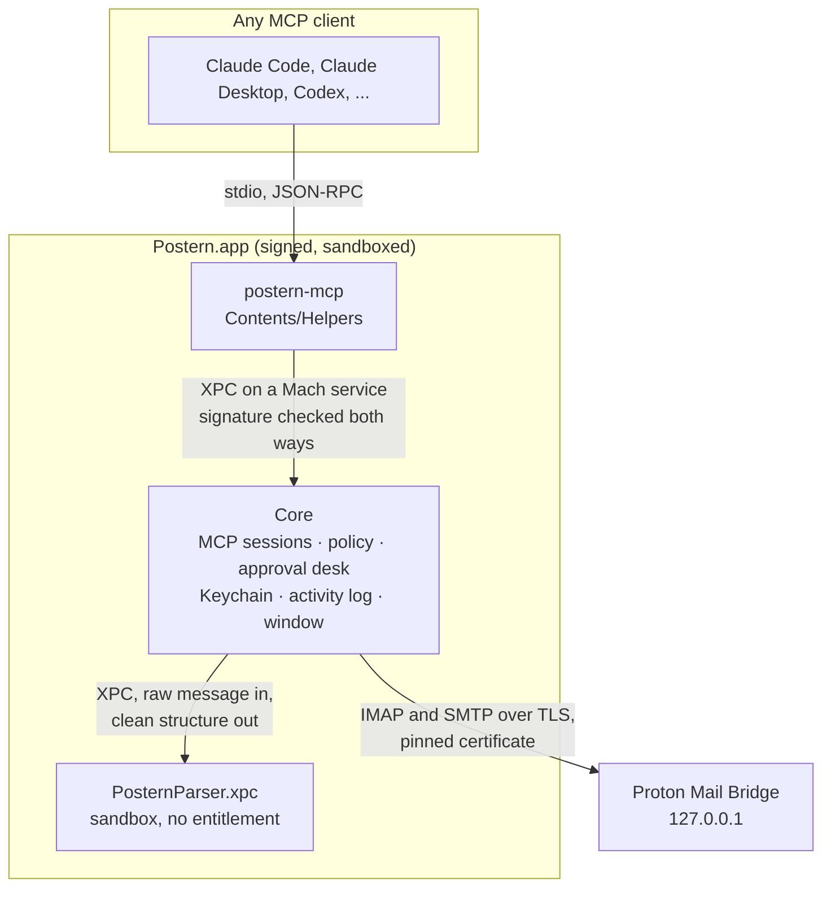

# Architecture

Postern is three processes, each with as little power as its job needs.

## The relay: `postern-mcp`

What MCP clients launch, over stdio. It reads one JSON-RPC message per line, sends it to the core over XPC, and
writes the core's answers back. It tells the core the name of the process that launched it, so the activity log can
say which app called. It holds no secret and makes no decision. If the core can't be reached, it answers the
client's pending requests with an error that says how to open Postern.

## The core: `Postern.app`

One process hosts everything that matters:

- **MCP sessions**, one per connected client, built on the official MCP Swift SDK. Each session lists only the tools
  that are on, and sends `tools/list_changed` when you change a switch.
- **The policy**: which tools are on, hidden mailboxes, sending limits, allowed and trusted recipients, pause. One
  JSON item in the data protection Keychain.
- **The approval desk**, the only place that can produce an approved message or an approved deletion. It shows a
  panel, waits for your choice for up to two minutes, then asks for Touch ID. One panel at a time.
- **The Bridge clients**: IMAP and SMTP on SwiftNIO, TLS with the pinned certificate, STARTTLS or TLS from the first
  byte depending on the port.
- **The activity log**: one JSON line per call, each chained to the previous one by its SHA-256, the latest hash kept
  in the Keychain.
- **The window**, in SwiftUI.

### How the core starts

The core is registered as a launch agent with `SMAppService`. Its plist declares two Mach services:

- `<team>.ch.rubencatalao.postern.core`, for relays,
- `<team>.ch.rubencatalao.postern.app`, for the window.

launchd starts the core when a relay connects. When you open Postern from the Finder or the Dock, macOS starts a
second copy of the app; that copy asks the core, on the window service, to show its window, hands it the focus and
quits. So there is only ever one Postern: one policy in memory, one menu bar icon, one Dock icon while the window is
open. If the background item is turned off in Login Items, the copy you opened shows the window itself and says so.

## The parser: `PosternParser.xpc`

An XPC service embedded in the app, with App Sandbox and no other entitlement: it cannot open a connection, read
the Keychain or touch a file. It receives the raw bytes of one message and returns either a sanitized structure
(headers, cleaned text, links, attachment list, sender verdict) or the bytes of one attachment. The core never
decodes mail itself.

## A read, step by step

1. The client calls `get_message` with an id.
2. The session checks that the tool is on, that the mailbox is not hidden and that Postern is not paused.
3. The core fetches the raw message from Bridge, refusing anything over 25 MB before downloading it.
4. The parser decodes and cleans it.
5. The session wraps the content in the untrusted envelope with a fresh random marker and returns it.
6. The activity log records the time, the app, the tool, the result and the count.

## A send, step by step

1. The client calls `reply_to_message`.
2. The session checks the switch, the recipients against the allowed list, and the hourly and daily limits.
3. It builds the message, cleaned of invisible characters, and asks the desk.
4. The desk shows the panel with the whole message, the provenance warnings and the attachments, and waits.
5. You choose Send, then pass Touch ID. The desk returns an `ApprovedMessage` bound to the message's SHA-256.
6. The SMTP client sends exactly those bytes. Bcc recipients get the email but never appear in its headers.

## Code layout

The app targets live at the root (`App`, `ParserService`, `Relay`, `Shared`). Everything testable lives in the Swift
package `Packages/PosternKit`, split by responsibility; see [CONTRIBUTING.md](../CONTRIBUTING.md#project-layout).
The Xcode project is generated from `project.yml` by XcodeGen.
